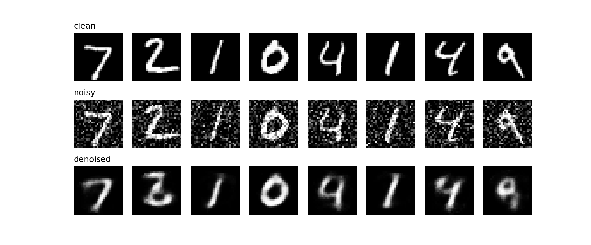
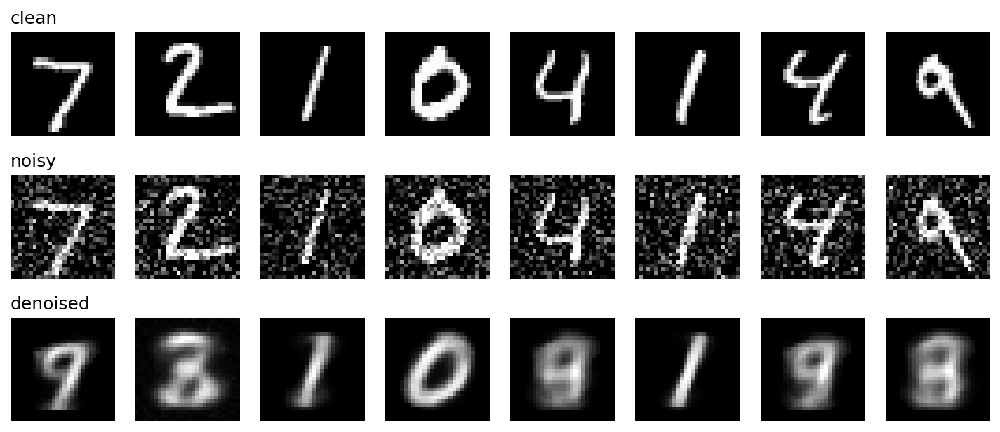
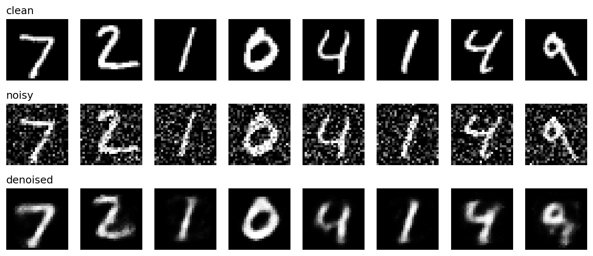
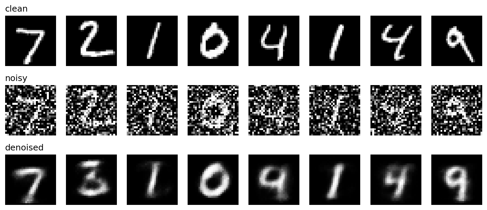

# Denoising Autoencoder on MNIST

A small PyTorch denoising autoencoder trained on a 10,000-image subset of MNIST.
The model receives a noisy digit and learns to reconstruct the clean original.
Built as a first project for learning about autoencoders.


*Top: clean test images. Middle: with Gaussian noise (σ = 0.3). Bottom: model output.*

## How it works

- **Noise:** Gaussian noise with standard deviation `sigma` is added to each image
  and clipped to [0, 1]. Fresh noise is sampled every batch.
- **Model:** a fully connected autoencoder. The encoder compresses 784 pixels into a
  `latent`-dimensional vector, and the decoder reconstructs the image.
- **Training:** MSE loss between the reconstruction of the *noisy* input and the
  *clean* image, optimized with Adam (lr = 1e-3, 10 epochs).

## Run it

```bash
pip install -r requirements.txt
jupyter notebook autoencoder.ipynb
```
MNIST downloads automatically on first run.

## Experiments

Each run changes a single variable from the baseline ('latent=32', 'sigma=0.3)

| latent | sigma | final train loss | observation |
|--------|-------|------------------|-------------|
| 32     | 0.3   |   0.0245         | baseline    |
| 2      | 0.3   |   0.0516         | clearer image but less precise|
| 32     | 0.6   | 0.0340           | better quality, low precision |
| 128    | 0.3   |   0.0222         |             |

### Effect of latent size

*Smooth and clean outputs, but often gets the number wrong*



### Effect of noise level


*Cleaner outputs but sometimes gets the number wrong*

## What I learned

[to finish]

## Next steps

- Try a convolutional autoencoder